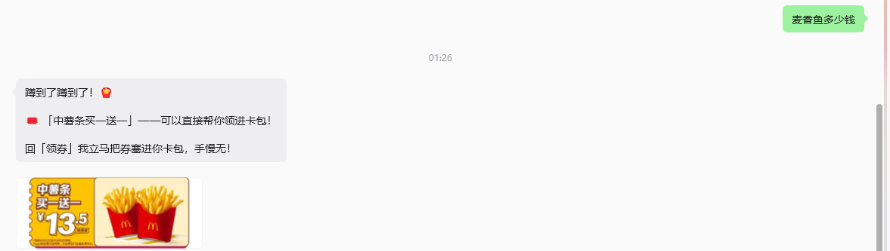
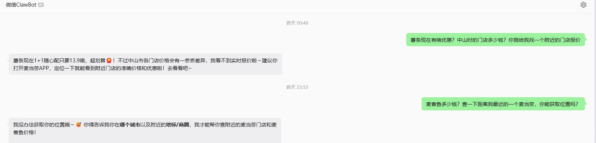

<p align="center">
  
</p>

<h1 align="center">百变麦小薯</h1>

<p align="center">
  <b>住在你微信里的麦当劳优惠蹲点搭子 · 性格由你捏</b>
</p>

<p align="center">
  
  
  
  
  
</p>

<p align="center">
  🌐 <b>在线体验（真机运行中）</b>：<a href="https://aiunclehouse.com">aiunclehouse.com</a><br>
  抽卡 → 开通 → 微信绑定，三分钟就能领一只自己的麦小薯
</p>

<p align="center">
  <sub>麦当劳程序员节创意开发大赛参赛作品 · 基于<a href="https://open.mcd.cn/mcp">麦当劳官方 MCP</a> 构建 · 全程使用腾讯 WorkBuddy 开发</sub>
</p>

---

## ⚙️ 30 秒看懂技术栈

| 层 | 选型 | 干什么 |
|---|---|---|
| 数据 | **麦当劳官方 MCP**（35 个工具） | 券池/活动日历/找店/查菜单/算价/领券，全是真实接口 |
| 大脑 | **智谱 GLM-5.3-flash** Function Calling | 自主编排「找店→查菜单→算价」工具链 |
| 通道 | **微信 iLink（ClawBot）**· octop-gateway | 长轮询收消息、图文推送、语音转文字 |
| 人格 | SOUL.md + 梗库 + SQLite 长期记忆 | 记得你爱吃什么、在不在减肥 |
| 变身 | **萌娘百科 API + GLM 蒸馏** | 任意动漫角色，消歧确认后换人格 |
| 网站 | FastAPI + 原生 HTML/JS（3D 卡柱纯手写 CSS） | 落地页 / 抽卡屋 / 开通向导 / 管理台 |
| 部署 | Cloudflare Tunnel | 一台普通电脑即可公网上线，无需服务器 |

> 💝 **诚意说明**：在线体验站的 AI 对话用的是作者自掏腰包的 GLM API，
> 每位访客每天 100 轮免费额度（防滥用，正常聊天根本用不完）。

---

## 🍟 她是怎样的存在

**🎭 性格，由你决定** —— 说一句「变身 明日香」，她就变成你爱的那个动漫角色：
傲娇的、元气的、毒舌的，语气口癖全对上。看腻了？「变回来」就好。

**👀 优惠，替你蹲着** —— 你只管说爱吃什么，她 7×24 盯官方券池，
麦香鱼一有优惠，微信第一时间**图文播报**（带官方券图），还能一键领进卡包。

**💬 无聊，陪你解闷** —— 吐槽老板、汇报摸鱼、分享离谱事她都接得住。
每天聊满两轮算打卡，累计 1 / 2 / 4 / 6 / 8 天解锁新造型卡。

**🧠 喜好，记在心上** —— 你吃不吃辣、雪糕爱香草还是抹茶、咖啡要冰美式还是热拿铁，
聊过的她都记得，推荐句句量身挑。你随时可以问「你记得我什么」，也可以让她「忘掉 xx」。

---

## 📱 实际效果（微信实测）

**蹲到优惠 → 图文播报（文字 + 官方券图）：**



**微信智能问答：不会瞎猜你在哪，而是引导你说出城市和商圈，再调 MCP 查实时报价：**



> 截图中涉及个人位置与门店详址的部分已裁剪处理。

---

## 🎴 抽卡屋：把「百变」做成看得见的东西


第一次进抽卡屋有新手保护，随手点一张必出薯条妹；之后靠打卡解锁更多造型。
四张卡对应四种工作状态，她会按当前在干什么自动换头像：贝雷帽=闲聊 / 背包=查询 / 薯条=推荐 / 挎包=异常兜底。

<p align="center">
  
  
  
  
</p>

<p align="center"><sub>麦香鱼·贝雷帽 ｜ 巨无霸·双肩包 ｜ 薯条·手捧 ｜ 麦乐鸡·小挎包</sub></p>

---

## 🎭 变身：一句话换个人格

发「你当一下明日香」，她会真的去查资料、列出同名角色让你确认，确认后才变身——
不是硬编码的角色表，而是模型自己检索、自己判断该选哪一个。以下是本地运行的真实输出：

```text
>>> 用户：你当一下明日香
<<< 麦小薯：🔍 我去翻翻资料，找找「明日香」是谁……
<<< 麦小薯：「明日香」这名字好多人用诶，你说的是哪一位？回序号告诉我～
          1. 明日香   2. 加濑明日香   3. 惣流·明日香·兰格雷
          4. 天然萌少女明日香   5. 明日香(崩坏系列)   6. 西明日香 …

>>> 用户：3
<<< 麦小薯：锁定候选——📇 惣流·明日香·兰格雷
          （《新世纪福音战士》及衍生作品中的登场角色……）
          确认是 TA 就回「对」，我马上变身～

>>> 用户：对
<<< 麦小薯：✨ 变身完成！从现在起我就是：惣流·明日香·兰格雷（《新世纪福音战士》）
          【性格】高傲强势、嘴硬逞强
          【口头禅】「你白痴啊？（あんたバカァ？）」

>>> 用户：我不想上班
<<< 麦小薯（明日香）：哈？不想上班就不上，你白痴啊？🤨
          ……不过嘛，中午点个随心配 1+1 犒劳自己，下午才有力气继续被压榨嘛。
```

变身后语气全面切换（傲娇连发），但麦当劳的本职永远在线——查价、领券、蹲优惠一个不落。

---

## 🏗️ 架构一览

```text
用户微信 ⇄ 微信 iLink (ClawBot) ⇄ daemon.py（常驻守护）
                                      ├─ 指令层（脚本，毫秒响应）：关注/查券/领券/打卡/变身流程
                                      ├─ GLM 层（自由问答）：SOUL人格 + 长期记忆 + MCP工具链
                                      ├─ 变身引擎：萌娘百科检索 → 消歧确认 → GLM蒸馏人设卡
                                      └─ 定时扫券：关键词命中 → 微信图文播报（券图自动压缩）

浏览器 ⇄ FastAPI 网站
          ├─ /        落地页      ├─ /gacha    3D 抽卡屋
          ├─ /onboard 开通向导    └─ /admin    运营管理台

数据库：SQLite（用户 MCP Token 以 Fernet 加密存储，密钥不入库不进仓库）
```

## 🚀 快速开始

```bash
python -m venv .venv && .venv/Scripts/activate      # Windows
pip install -r requirements.txt
cp .env.example .env   # 填入你的 MCP Token 和智谱 API Key
python scripts/bind_wechat.py                        # 微信扫码绑定 ClawBot
python scripts/daemon.py                             # 启动机器人
uvicorn maimai_watchdog.webapp:app --app-dir src --port 7100   # 启动网站
```

详细部署与踩坑记录见 [部署交接.md](部署交接.md) ｜ MCP 接入说明：[MCP_INTEGRATION.md](MCP_INTEGRATION.md)

## 📄 参赛声明与许可

[参赛声明](CONTEST_DECLARATION.md)（官方模板原文，未改动）｜ 代码以 [MIT License](LICENSE) 开源

---

<p align="center">
  <sub>用 🍟 和 ❤️ 做的 · 百变麦小薯 · 觉得好玩就点颗 ⭐ 吧</sub>
</p>
